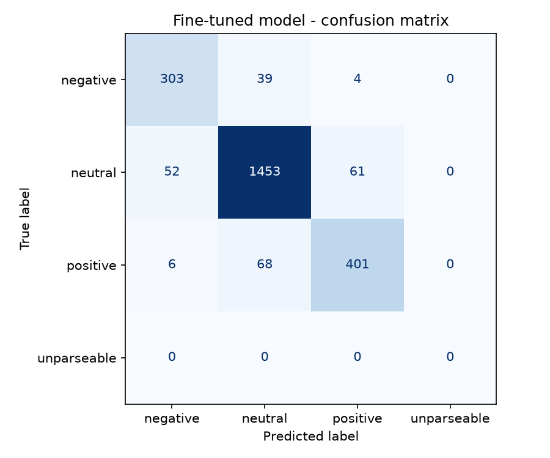

# Llama-3.2-1B Financial Sentiment Analysis (QLoRA Fine-Tuning)

**Built with Llama.**

A hands-on practice repository demonstrating parameter-efficient fine-tuning (**PEFT / QLoRA**) on **Llama-3.2-1B** using **TRL** and **BitsAndBytes (4-bit)** for financial sentiment classification, with a held-out evaluation against baselines.

**Hugging Face Model Adapter:** [Yutakuroda/llama-3.2-1b-fingpt-sentiment](https://huggingface.co/Yutakuroda/llama-3.2-1b-fingpt-sentiment)

---

## Project Overview

Fine-tuning open-weights Large Language Models (LLMs) on domain-specific classification tasks efficiently on consumer hardware. This experiment trains Meta's `Llama-3.2-1B` on the `FinGPT/fingpt-sentiment-train` dataset to classify financial news and market headlines into sentiment categories (`positive`, `neutral`, `negative`).

### Key Highlights:

- **Base Model:** `meta-llama/Llama-3.2-1B`
- **Fine-Tuning Method:** QLoRA (4-bit NormalFloat quantization via `bitsandbytes`)
- **Dataset:** `FinGPT/fingpt-sentiment-train` (~76.8k samples)
- **Trainable Parameters:** ~11.27M / 1.25B (~0.90% of total weights)
- **Hardware:** Local NVIDIA GPU (RTX 3080 12GB VRAM)
- **Held-out result:** 90.4% accuracy / 0.880 macro-F1 on 2,387 financial tweets (majority-class baseline: 65.6% / 0.264)

---

## Live Demo

You can try it here: https://fin-sentiment-analyzer.streamlit.app

## Training Configuration

| Hyperparameter              | Value                                                                       |
| :-------------------------- | :-------------------------------------------------------------------------- |
| **Quantization**            | 4-bit NF4 (`bnb_4bit_compute_dtype=bfloat16`)                               |
| **LoRA Rank ($r$)**         | 16                                                                          |
| **LoRA Alpha ($\alpha$)**   | 32                                                                          |
| **Target Modules**          | `q_proj`, `k_proj`, `v_proj`, `o_proj`, `gate_proj`, `up_proj`, `down_proj` |
| **Batch Size (Per Device)** | 2                                                                           |
| **Gradient Accumulation**   | 8 (Effective batch size = 16)                                               |
| **Learning Rate**           | `2e-4`                                                                      |
| **Epochs**                  | 1.0 (4,799 steps)                                                           |
| **Average training loss**   | ~1.02 (mean over the whole run, not the final-step loss)                    |
| **Token accuracy**          | ~85.3% (computed over all tokens, including the prompt text)                |

The training loss and token accuracy are training diagnostics only. They are computed over every token of the formatted text (instruction, input and answer), so they are **not** a measure of sentiment-classification accuracy. See the next section for that.

---

## Evaluation

**Test set:** the `validation` split of `zeroshot/twitter-financial-news-sentiment` (2,388 rows). One row was removed because its text exactly matched a training input, leaving 2,387 rows. Greedy decoding, with the same 4-bit configuration as training. The notebook is `evaluation.ipynb`.

| System                                          | Accuracy | Macro-F1 | Unparseable output |
| :---------------------------------------------- | -------: | -------: | -----------------: |
| Majority class (always "neutral")               |    0.656 |    0.264 |                 0% |
| Base Llama-3.2-1B (adapter disabled, zero-shot) |    0.222 |    0.289 |              35.3% |
| **Fine-tuned (QLoRA adapter)**                  |  **0.904** |  **0.880** |             **0%** |

Per-class results for the fine-tuned model:

| Class    | Precision | Recall | F1    | Support |
| :------- | --------: | -----: | ----: | ------: |
| negative |     0.839 |  0.876 | 0.857 |     346 |
| neutral  |     0.931 |  0.928 | 0.930 |    1566 |
| positive |     0.861 |  0.844 | 0.852 |     475 |



**Error analysis.** 230 of 2,387 predictions are wrong. 220 of them involve the neutral boundary (neutral predicted as negative/positive, or negative/positive predicted as neutral); only 10 swap negative and positive. Most of the remaining error is therefore about whether a headline expresses any direction at all, which is also where labels in this kind of dataset are most ambiguous.

**How to read these numbers**

- The majority-class baseline is the meaningful bar: neutral is the largest class, so always answering "neutral" already reaches 65.6% accuracy. Macro-F1 shows whether the minority classes are handled.
- The base model is not instruction-tuned, and 35.3% of its outputs could not be parsed as a label. Its score mostly reflects failing to follow the output format, so it is a weak baseline.
- Approximate 95% interval on the fine-tuned accuracy: +/- 1.2 points (normal approximation, n = 2,387).

**Limitations**

- Single run, three-class sentiment on financial tweets only. The 7-class news format that also appears in the training data is not evaluated.
- The training mix likely contains the training split of the same tweet source, so this is an in-distribution test (same source, different split), not an out-of-domain one.
- The leakage check is an exact match after lower-casing and whitespace normalization. Near-duplicates (for example the same tweet with a different URL) are not detected, so the result may be slightly optimistic.

**Reproduce**

```bash
pip install scikit-learn pandas matplotlib
jupyter notebook evaluation.ipynb
```

Set `MAX_EVAL_SAMPLES = 300` first for a quick smoke test, then `None` for the full set. Results are written to `eval_results.json` and `confusion_matrix.png`.

---

## Project Structure

```text
├── app.py                        # Streamlit web application
├── lora_qlora_finetuning.ipynb   # Training notebook (QLoRA fine-tuning workflow)
├── evaluation.ipynb              # Held-out evaluation: baselines, leakage check, metrics
├── eval_results.json             # Evaluation results
├── confusion_matrix.png          # Confusion matrix of the fine-tuned model
├── requirements.txt              # Required Python packages
├── .gitignore                    # Ignored model checkpoints and cache
└── README.md                     # Project documentation
```

## Setup & Installation

1. **Clone the repository:**

```bash
git clone https://github.com/Yutakuro9029/llama3.2-qlora-finetuning-practice.git
cd llama3.2-qlora-finetuning-practice
```

2. **Install dependencies:**

```bash
python -m venv venv
source venv/bin/activate       # Windows: venv\Scripts\activate
pip install -r requirements.txt
```

3. **Set up Environment Variables:**
   Create a `.env` file in the root directory:

```env
HF_TOKEN=your_huggingface_read_token
WRITE_TOKEN=your_huggingface_write_token
```

---

## Quick Inference

You can run inference directly using the trained LoRA adapter hosted on Hugging Face:

```python
import torch
from transformers import AutoModelForCausalLM, AutoTokenizer
from peft import PeftModel

base_model_name = "meta-llama/Llama-3.2-1B"
adapter_name = "Yutakuroda/llama-3.2-1b-fingpt-sentiment"

# 1. Load tokenizer and base model
tokenizer = AutoTokenizer.from_pretrained(adapter_name)
base_model = AutoModelForCausalLM.from_pretrained(
    base_model_name,
    torch_dtype=torch.bfloat16,
    device_map="auto"
)

# 2. Attach LoRA adapter
model = PeftModel.from_pretrained(base_model, adapter_name)
model.eval()

# 3. Test prompt
prompt = """Instruction:
What is the sentiment of this news? Please choose an answer from {negative/neutral/positive}.

Input:
Tesla beats quarterly revenue expectations as electric vehicle deliveries hit record highs.

Answer:
"""

inputs = tokenizer(prompt, return_tensors="pt").to(model.device)
with torch.no_grad():
    output = model.generate(
        **inputs,
        max_new_tokens=15,
        do_sample=False,
        pad_token_id=tokenizer.pad_token_id,
        eos_token_id=tokenizer.eos_token_id
    )

prompt_len = inputs["input_ids"].shape[1]
raw_output = tokenizer.decode(output[0][prompt_len:], skip_special_tokens=True).strip()
prediction = raw_output.split("Instruction")[0].strip()

print(f"Predicted Sentiment: {prediction}")
# Output: positive
```

---

## Dataset Credit

**Training data:** [`FinGPT/fingpt-sentiment-train`](https://huggingface.co/datasets/FinGPT/fingpt-sentiment-train), from the Hugging Face Hub (AI4Finance Foundation). About 76.8k instruction-formatted financial sentiment samples.

- **License:** the dataset card does not declare a license, and the data is compiled from several public financial-text sources whose own terms may differ. No license is asserted for it here, and it is used for educational and research practice only. Anyone reusing it should check the terms of the original sources.
- **Modifications made for this project:** the dataset records (`instruction`, `input`, `output`) were formatted into structured instruction-tuning prompts with EOS tokens for causal language modeling; original text entries and label values were not altered.

**Evaluation data:** [`zeroshot/twitter-financial-news-sentiment`](https://huggingface.co/datasets/zeroshot/twitter-financial-news-sentiment), `validation` split, used only for evaluation and never for training.

- **License:** [TODO: confirm the license shown on the dataset page and replace this line with it]
- **Modifications made for this project:** numeric labels were mapped to words (0 to negative, 1 to positive, 2 to neutral); one row was removed by the leakage check.

---

## License

Code in this repository is licensed under the **MIT License**. This license applies to the code and notebooks only:

- The base model weights (`meta-llama/Llama-3.2-1B`) are subject to the **Llama 3.2 Community License Agreement** and Acceptable Use Policy by Meta (see the [model page](https://huggingface.co/meta-llama/Llama-3.2-1B)). The LoRA adapter published on Hugging Face is a derivative of Llama 3.2 and is subject to the same terms.
- The datasets are covered by the terms described under **Dataset Credit** above, not by this repository's MIT license.
